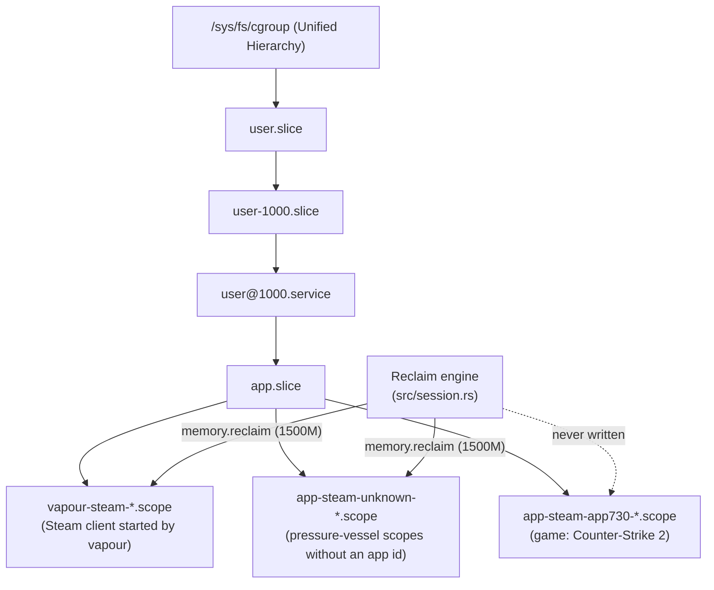
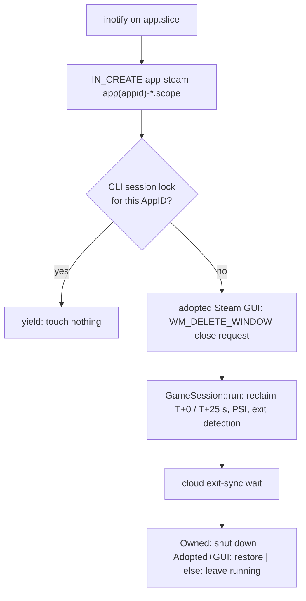

# Vapour: Technical Architecture & Kernel Systems Notes

**Author:** pb  
**Version:** `0.0.1-alpha.1`  
**Target:** Linux x86_64 / aarch64, cgroups v2 unified hierarchy. `memory.reclaim` needs Linux 5.19 `[spec: https://docs.kernel.org/admin-guide/cgroup-v2.html]`; the `swappiness=` bias needs 6.11 (same page).

> Steam-side facts (flags, log formats, scope names) were last verified on 2026-11-16 against the client installed then; rerun the checks in [`docs/research/verification.md`](docs/research/verification.md) after major Steam client updates.
>
> **Provenance tags.** Technical claims carry one tag: `[spec: <url>]` (documented upstream), `[measured: <date>, <machine>, <command>]` (observed here), `[design: <file>]` (what the code intends), `[empirical]` (a working assumption with no source yet), `[unverified]` (a figure nobody has reproduced). Tuning constants are collected in one table in section 10.

---

## 1. Executive Summary & Architecture

Steam's desktop client embeds Chromium (CEF) webviews that keep several processes resident while idle. Vapour starts Steam headless and moves that idle memory into zRAM, or runs a game without the client at all.

Footprint of one measured run `[measured: 2026-11-02, CachyOS 7.3.1, scripts/benchmark.sh -> benchmarks/BENCHMARK_RESULTS.md]`:

| | RSS before reclaim | RSS after reclaim | In zRAM |
| :--- | :---: | :---: | :---: |
| Steam client + CEF helpers | 1213 MB | 44 MB | 946 MB (4.29x compression) |

The "1,660 MB native footprint" quoted in earlier drafts is `[unverified]`: the benchmark file records the 1213 MB pre-reclaim figure, not a native-GUI baseline.

Vapour:
1. Launches games through `steam -silent -applaunch <id>` or through direct runners (`ProtonDirectRunner`, `NativeDirectRunner`) `[design: src/runner.rs]`. Only the `-applaunch` path keeps the Steam client in the loop (overlay, Cloud, Steam Input, Workshop). The direct runners bypass the client, so none of those apply.
2. Writes `memory.reclaim` in Steam's cgroups so idle daemon heap is paged out to swap/zRAM `[spec: cgroup-v2]`.
3. Never writes to the game's own scope: `find_steam_cgroup_dirs` excludes `app-steam-app*` leaf names `[design: src/session.rs]`.

---

## 2. Linux cgroups v2 & User Delegation



### Delegation

`user@UID.service` delegates `memory` to the user's subtree on systemd 262 (`Delegate=pids memory cpu`) `[spec: https://systemd.io/CGROUP_DELEGATION/]`. `memory.reclaim` needs no capability in the kernel `[spec: mm/memcontrol.c, v6.12]`, and systemd chowns it to the user in delegated subtrees `[measured: 2026-11-16, CachyOS 7.3.4, systemd 262.2, ls -l .../app.slice/memory.reclaim -> --w------- owned by the user]`. The release that started chowning it is not known.

systemd documents that you should only write attributes of cgroups delegated to you. Vapour starts its Steam scope with `systemd-run --user --scope -p Delegate=yes` so that rule holds `[design: src/launcher.rs]`. `memory.reclaim` in such a scope still answers (EAGAIN or success) and systemd still accounts the scope `[measured: 2026-11-16, same machine, systemd-run --user --scope -p Delegate=yes --unit=probe-x sleep 30]`.

### The reclaim request

Vapour writes `1500M swappiness=200\n` `[design: src/session.rs write_reclaim_request]`.

- `swappiness=` in `memory.reclaim` exists from Linux 6.11 `[spec: cgroup-v2]`. On older kernels the first write returns `EINVAL` (inferred from the kernel source, not tested on 5.19-6.10); Vapour then remembers that and writes plain `1500M\n` for the rest of the process `[design: SWAPPINESS_STATE]`.
- Reclaim scans both anonymous and file LRUs. Only `swappiness=max` (6.16) is documented as anon-only `[spec: cgroup-v2]`; Vapour does not use it yet.
- `EAGAIN` means a partial reclaim and is treated as success `[spec: cgroup-v2]` (invariant 8).
- "Freed" is the drop in `memory.current`, which includes dropped page cache. The net saving is that drop minus the growth of zRAM `mem_used_total` `[spec: cgroup-v2, zram]`; the reported "in zRAM" figure is the change in `memory.swap.current`.

---

## 3. Steam Scopes & Container Geometry

### Where scopes come from

| Scope name | Created by | Reclaim target? |
| :--- | :--- | :---: |
| `vapour-steam-<pid>.scope` | Vapour (`systemd-run`), when it starts Steam | yes |
| `app-steam-unknown-<pid>.scope` | pressure-vessel, which fills `app-%s-%s-%s` with `unknown` when there is no app id `[measured: 2026-11-16, strings on pressure-vessel-wrap + 90 such scopes in the journal]` | yes |
| `app-steam-app<appid>-<pid>.scope` | `steam-launch-wrapper` when `STEAM_LAUNCH_WRAPPER_SCOPE` is set `[measured: 2026-11-16, strings on steam-launch-wrapper]` | **never** |

- pressure-vessel creates its scopes by calling D-Bus `StartTransientUnit` itself; it does not run `systemd-run` `[measured: 2026-11-16, strings on pressure-vessel-wrap]`. Whether `PRESSURE_VESSEL_SYSTEMD_SCOPE=1` is the default is not known; Vapour sets it explicitly.
- What runs inside `app-steam-unknown-*` is unproven; most of these scopes live 1-5 s `[measured: 2026-11-16, journal]`.
- Scopes land directly in `app.slice`, also under uwsm `[measured: 2026-11-16, systemd-run --user --scope probe]`. The main `steam` process may sit in a `session-N.scope`, which the `/proc` fallback covers.

### Targeting algorithm

[`find_steam_cgroup_dirs()`](src/session.rs):

1. Scan `app.slice` for `vapour-steam-*.scope` and `app-steam-unknown-*.scope` that expose `memory.reclaim`.
2. Add the cgroup of the `steam` PID and every `steamwebhelper` PID, read from `/proc/<pid>/cgroup`.
3. Drop any directory whose **leaf name** starts with `app-steam-app` (ancestor directories are not inspected).
4. Deduplicate and write the reclaim request to each.

---

## 4. Adaptive Memory Eviction

```mermaid
sequenceDiagram
    participant Vapour as Vapour engine
    participant Kernel as Linux Kernel (PSI)
    participant Cgroup as Steam Cgroups

    Note over Vapour,Cgroup: scheduled passes (CLI: T+12s, T+40s; daemon: T+0, T+25s)
    Vapour->>Cgroup: write "1500M swappiness=200" to memory.reclaim
    Vapour->>Kernel: register PSI trigger "some 300000 2000000"
    Kernel-->>Vapour: POLLPRI when tasks stalled 300 ms within 2 s
    Vapour->>Cgroup: reactive reclaim pass (cap and cooldown per driver)
```

### Pressure Stall Information

`/proc/pressure/memory` exists from Linux 4.20 `[spec: https://docs.kernel.org/accounting/psi.html]`. `some avg10` is the share of the last 10 s in which at least one task stalled on memory (same page).

After the scheduled passes, Vapour waits on a PSI trigger instead of polling: it opens `/proc/pressure/memory`, writes `some 300000 2000000` and `poll`s for `POLLPRI`. A window that is a multiple of 2 s is what unprivileged triggers need on 6.4+ `[spec: psi]`. If the write is refused, it falls back to reading `some avg10` and reacting at `>= 5.0` `[empirical]` (avg10 lags real stalls by up to ~10 s).

### Schedules differ by driver

| | CLI (`vapour <game>`) | Daemon (`vapour daemon`) |
| :--- | :--- | :--- |
| Scheduled passes | T+12 s, T+40 s | T+0, T+25 s |
| PSI-driven passes | at most 4 | no cap (off when `psi_adaptive = false`) |
| PSI cooldown | 15 s | 10 s |

Both run the same engine ([`GameSession::run`](src/session.rs)); only the policy differs `[design: src/watcher.rs, src/daemon.rs]`. PSI passes start only after the schedule has finished.

### zRAM & swappiness

`vm.swappiness` accepts 0-200 since Linux 5.8, and values above 100 suit zRAM `[spec: https://docs.kernel.org/admin-guide/sysctl/vm.html]`. [`check_swap()`](src/doctor.rs) warns when it is lower.

---

## 5. Process Discovery & Signalling

- Signals go through a pidfd (`pidfd_send_signal`) once one is open, so a PID recycled after the pidfd exists cannot be hit; `kill(2)` is the fallback when `pidfd_open` fails `[spec: https://man7.org/linux/man-pages/man2/pidfd_send_signal.2.html]`. The window between a `/proc` scan and `pidfd_open` remains, so this narrows the race rather than removing it.
- `get_steam_pid()` scans `/proc` for `comm == steam` (comm is limited to 15 characters `[spec: proc_pid_comm(5)]`) and trusts `~/.steam/steam.pid` only if that PID's comm is `steam`.
- Games are found first by their scope; the fallback is the initial environment of `/proc/<pid>/environ` (`SteamAppId`, `SteamGameId`), matched on whole NUL-separated entries `[spec: proc_pid_environ(5)]`.

### Steam Cloud exit sync

On exit Steam logs, per AppID `[measured: 2026-11-16, ~/.local/share/Steam/logs/cloud_log.txt, grep 'AC Exit']`:

1. `Starting sync (up,AC Exit,)`
2. `AutoCloud complete`
3. `Currently already synced …`
4. `Need to upload file …`
5. `Upload OK for file …`
6. `Upload complete, result OK` (or `Upload complete in build list` when nothing changed)

`AutoCloud complete` and `already synced` appear *before* the upload, so only step 6 counts as completion. `cloud_step` is a small state machine (`Waiting -> ExitSyncStarted -> Done | Conflict`) tested against a sanitized real log ([`tests/fixtures/cloud_log_exit.txt`](tests/fixtures/cloud_log_exit.txt)). Once the exit sync has started the wait ends only on completion, a conflict or the 60 s cap, and a cap hit prints a warning that Steam's log format may have changed. Only bytes appended after the game exited are read (invariant 6); a `cloud_log.txt` written in the last 2 s blocks SIGTERM `[empirical]` (invariant 7).

The conflict markers (`conflict`, `mismatch`, `files differ`) are a guess: no conflict has appeared in the 4,931 log lines checked `[empirical]`.

---

## 6. Configuration & Atomic Writes

Resolution order is CLI flags > per-game `settings.toml` > `[defaults]` > Steam's `localconfig.vdf` `[design: src/config.rs]` (invariant 11).

### Atomic file protocol

Persistent files are written by [`write_atomic()`](src/non_steam.rs) `[design]`:
1. Write the whole payload to `<stem>.tmp.<pid>` in the same directory.
2. `sync_all()` the temp file, then `rename` it over the destination.
3. Remove the temp file on failure.

This survives a killed process; with the fsync it also survives power loss `[spec: rename(2), fsync(2)]`. The `/dev/shm` CLI session lock is exempt: it is ephemeral by design.

### Binary VDF

`shortcuts.vdf` uses types `0x00` (map), `0x01` (string), `0x02` (int32), `0x07` (int64) and `0x08` (end). Steam's format has more types (`0x03`-`0x06`, `0x0A`, `0x0B`); Vapour handles the subset shortcuts use `[spec: https://github.com/ValvePython/vdf]`. A single walker ([`walk_entries`](src/non_steam.rs)) backs parse, update, append and delete, with golden byte tests and a `proptest` fuzz harness.

The long shortcut AppID is `(id32 << 32) | 0x02000000` `[spec: open-source reimplementations, e.g. Steam-ROM-Manager]`. New shortcuts use `CRC32(exe + name) | 0x80000000`, which is the legacy formula and does not match the `appid` values Steam stores locally `[measured: 2026-11-16, local shortcuts.vdf]`; existing shortcuts keep the stored value.

---

## 7. Process Supervision

### Game exit

Exit detection, in order `[design: src/session.rs GameSession::run]`:
1. **Scope populated.** When the game's `app-steam-app<id>-*.scope` is known, an inotify `IN_MODIFY` watch on its `cgroup.events` wakes the engine; exit is `populated 0` or the scope being gone `[spec: cgroup-v2, cgroup.events]`. A launcher handoff keeps the scope populated, so no grace guess is involved.
2. **pidfd / `/proc` ticks (fallback).** Without a scope the engine tracks PIDs (pidfd when available, `/proc/<pid>` otherwise; `pidfd_open` exists from Linux 5.3 `[spec: pidfd_open(2)]`). When all die it rescans for a successor and declares exit after 3 empty 2 s ticks (~6 s `[empirical]`).
3. **Log hint (CLI only).** For games that expose neither a scope nor `SteamAppId`, Steam's "app stopped running" line in `content_log.txt` ends the session.

`PidFd::open` falls back to `/proc` on any error, not only `ENOSYS`.

### Shared engine, two drivers

[`src/session.rs`](src/session.rs) holds the mechanism (detection, exit, reclaim, PSI, cloud wait, shutdown). The CLI watcher and the daemon differ only in policy:

| | CLI | Daemon |
| :--- | :--- | :--- |
| Steam GUI | never touched | tucked to the tray if the user's Steam (`Adopted`) |
| On exit | shut down a vapour-started Steam unless `--keep-steam` | `Owned` + `shutdown_if_headless`: shut down; `Adopted` with a GUI that was open + `restore_gui_on_exit`: restore it |
| Yields when | never (Ctrl+C detaches) | a CLI session lock for the AppID exists (checked every wake-up) or the daemon is stopping |

`Owned` means the Steam process lives in a `vapour-steam-*.scope`; a user's own `steam -silent` (e.g. tray autostart) is `Adopted` and never shut down.

### Telemetry parsing

Hot loops read `/proc/<pid>/status` and `/proc/pressure/memory` into fixed stack buffers instead of heap strings `[design: src/telemetry.rs]`.

### Mock cgroup test harness

[`tests/mock_cgroup_lifecycle.rs`](tests/mock_cgroup_lifecycle.rs) simulates a cgroup tree with `memory.reclaim`/`memory.current`/`memory.swap.current`, checks that game scopes are skipped, and uses `mkfifo` to show that `O_NONBLOCK` opens of an unread FIFO fail with `ENXIO` `[spec: open(2), fifo(7)]`.

---

## 8. Autopilot Supervisor Daemon (`vapour daemon`)

The daemon watches `app.slice` with inotify `IN_CREATE` (not recursive `[spec: inotify(7)]`) and wakes when a scope appears; it sleeps in `poll` otherwise.



### Closing the Steam GUI

For windows whose `WM_CLASS` contains `steam`, the daemon sends an ICCCM `WM_DELETE_WINDOW` `ClientMessage`, but only if the window lists it in `WM_PROTOCOLS` `[spec: ICCCM 4.2.8.1]`. It never calls `XUnmapWindow`: hiding to the tray is Steam's own reaction to the close request `[design: src/daemon.rs close_steam_gui_to_tray]`.

- Windows are found through `_NET_CLIENT_LIST`, falling back to `XQueryTree` `[spec: EWMH]`.
- `DIALOG`, `SPLASH` and `NOTIFICATION` window types, game/gamescope/overlay classes, and titles that look like launch or update prompts are skipped (invariant 14) `[spec: EWMH window types]`.
- An Xlib error handler that ignores errors is installed for the scan and restored before `XCloseDisplay`; Xlib's default handler calls `exit()` and a vanishing window would otherwise kill the daemon `[design]`.
- `libX11.so.6` is loaded with `dlopen`, so there is no link-time dependency.

Why close the window at all: a mapped CEF window may keep refetching swapped pages. The "carousel timer refetches every 20 s" figure is `[empirical]`, and "Chromium tears down its GPU context" is `[unverified]`.

### After the game

The engine waits for the exit sync described in section 5, then applies the exit policy. Restoring the library window runs `steam steam://open/games` `[unverified]` (not tested without a running Steam).

---

## 9. Benchmarks

One live run is recorded in [`benchmarks/BENCHMARK_RESULTS.md`](benchmarks/BENCHMARK_RESULTS.md) `[measured: 2026-11-02, CachyOS 7.3.1, scripts/benchmark.sh]`: 1213 MB RSS before reclaim, 44 MB after, 946 MB in zRAM at a 4.29x ratio, `vapour status --json` runtime 4 ms over 5 runs (CLI overhead, not game launch time).

Figures that appeared in earlier drafts and are **not** backed by that run: the 1,660 MB native baseline, 18 MB / 23 MB RSS, "1,420 MB" and "1,440+ MB" evicted, a "74x" compression ratio, "0 page faults" `[unverified]`.

### Handheld APUs

On a unified-memory device, freeing system RAM does not automatically become GPU memory: how much the GPU can use depends on the APU's firmware carve-out. The earlier "+15.2% GPU memory headroom" claim is `[unverified]`; freed RAM is available to the whole system, nothing more is claimed.

---

## 10. Tuning constants (empirical; adjust after measuring)

None of these are kernel or Steam facts.

| Constant | Value | Where |
| :--- | :--- | :--- |
| Reclaim size | 1500M | `write_reclaim_request` in `src/session.rs` |
| CLI scheduled passes | T+12 s, T+40 s | `CLI_RECLAIM_AT` in `src/watcher.rs` |
| Daemon scheduled passes | T+0, T+25 s | `DAEMON_RECLAIM_AT` in `src/daemon.rs` |
| PSI trigger | 300 ms stall in a 2 s window | `PsiTrigger::open` in `src/session.rs` |
| PSI polling fallback | `some avg10 >= 5.0` | `GameSession::run` in `src/session.rs` |
| PSI cap / cooldown | CLI 4 passes, 15 s; daemon uncapped, 10 s | policies in `src/watcher.rs`, `src/daemon.rs` |
| Fallback exit ticks | 3 x 2 s (~6 s) | `should_declare_exit`, `SessionPolicy.tick` |
| Cloud: quiet period / wait cap | 3 s / 60 s | `wait_cloud` in `src/session.rs` |
| Cloud: recent-write backstop | 2 s mtime | `shutdown_steam_gracefully` in `src/session.rs` |
| Steam shutdown wait | 10 s, then SIGTERM | `shutdown_steam_gracefully` |
| Orphan helper escalation | SIGTERM, poll 50 ms up to 1 s, then SIGKILL | `execute_prune` in `src/prune.rs` |

---

## 11. Conclusion

Vapour combines cgroups v2 delegation, PSI-triggered reclaim and scope isolation to keep an idle Steam client small while a game runs. How much it saves depends on the machine; the one recorded run is in section 9, and the tuning constants above are starting points, not guarantees.
